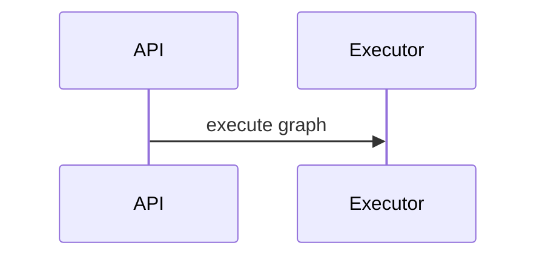

# Diagram contract

Read this reference whenever a run creates, updates, or reviews architecture, flow, concept, or lifecycle diagrams.

## Selection principle

Every diagram must answer a named learning question. Do not add diagrams as decoration or auto-dump an entire codebase. If a normally expected view is not useful or cannot be evidenced, record it in the manifest as `not_applicable` with a concrete reason.

Use Mermaid by default because it remains reviewable beside Markdown. Mermaid context, component, and deployment views are UML-style rather than strict UML. Use PlantUML or another strict notation only when the user explicitly requests strict UML and the renderer is available.

## Diagram roles and notation

| Role | Use when | Mermaid notation |
| --- | --- | --- |
| `system_structure` | Multiple actors, external systems, or at least three responsibility boundaries must be oriented | `flowchart` with manifest type `context` or `component` |
| `runtime_deployment` | Two or more processes, containers, data stores, queues, or external infrastructure interact at runtime | `flowchart` with manifest type `deployment` |
| `core_flow` | A representative flow has at least three hops or includes async work, callback, retry, timeout, or cancellation | `sequenceDiagram` |
| `domain_model` | At least three core types have meaningful inheritance, composition, or association | `classDiagram` |
| `lifecycle` | A real entity has at least three evidenced states and transitions | `stateDiagram-v2` |

An enum alone does not prove a state machine. A directory tree alone does not prove a component model.

## Mode requirements

- **full**: account for `system_structure`, `runtime_deployment`, and `core_flow`. Include an actual diagram when applicable; otherwise use a `not_applicable` manifest entry. Add `domain_model` and `lifecycle` only when they materially explain the repository. Each selected representative flow gets its own sequence view.
- **fast**: account for `system_structure` and `core_flow`. Prefer no more than two actual diagrams.
- **targeted**: update only diagrams relevant to target chapters and preserve unrelated diagram blocks and manifest entries. No repository-wide minimum applies.

## Evidence and truthfulness

- Every node must map to a real actor, symbol, module, process, container, store, queue, or external dependency.
- Every edge must map to a real import, call, request, message, event, persistence operation, transition, or declared dependency.
- Use source/deployment names exactly enough that a learner can search for them. Never invent generic `Controller`, `Service`, or `Repository` layers.
- Put a compact evidence index after the diagram with repository-relative `path:line` citations for its nodes and important edges. Add every cited file to both the chapter's `chapter_sources` and the diagram's `sources` manifest field.
- Label relationships inferred only from static code as `静态推断`; label unexecuted runtime behavior as `未运行` or `静态验证`.

## Readability limits

- One diagram communicates one view or learning question.
- Use at most 12 major nodes and 18 edges per diagram. Split larger views by subsystem or scenario.
- Use at most two visual nesting levels.
- Define non-obvious abbreviations in a legend or reading note.
- Keep labels concise; put explanations in prose below the diagram.

For sequence views, show the initiator and input, synchronous versus asynchronous boundaries, important transformations, persistence/events, return value, and at least one applicable failure/timeout/cancellation path.

For class views, include only core interfaces or bases, representative implementations, central entities, important signatures, and meaningful relations. Do not generate a complete class inventory.

For state views, include transition triggers, material guards, side effects or persistence, failure transitions, and terminal states when present.

## Markdown block contract

Each actual diagram has a unique lowercase kebab-case ID and this exact shape:

````markdown
### Graph execution lifecycle

**Purpose:** Explain how a graph run moves from request to persisted result.

<!-- diagram:graph-execution-sequence -->


**Reading note:** Solid arrows are synchronous calls; `-->>` is a response.

**Evidence:** `src/api.py:42`, `src/executor.py:18`

**Validation:** 静态验证（Mermaid 映射和元数据已检查；未执行渲染器）。

**Known gaps:** Runtime ordering was not observed.
````

The comment must immediately precede its Mermaid fence. The surrounding section must provide a title, purpose, reading note or legend, evidence, validation state, and known gaps (use `none identified` when appropriate).

## Manifest entries

Add a top-level `diagrams` array. An actual diagram uses:

```json
{
  "id": "graph-execution-sequence",
  "chapter": "04-core-flow.md",
  "role": "core_flow",
  "type": "sequence",
  "status": "static",
  "purpose": "Explain request-to-result execution and its failure path.",
  "sources": ["src/api.py", "src/executor.py"],
  "node_count": 2,
  "edge_count": 2,
  "reason": "Mermaid CLI was unavailable; deterministic structure checks passed."
}
```

Allowed actual statuses are `static` and `passed`. A `not_applicable` record has `status: "not_applicable"`, a non-empty `reason`, empty `sources`, and zero node/edge counts; it has no Mermaid block.

Also add `validation.diagrams`. Use `passed` only after a renderer exits successfully and record `command`, `exit_code: 0`, and `level: "render"`. Otherwise use `static` with a reason. Do not install a renderer solely to satisfy this contract.

The deterministic validator checks IDs, role/type compatibility, block registration, source paths, per-diagram size limits, mode coverage, and rendering claims. It does not prove semantic accuracy; the learning review must still compare nodes and edges against source evidence.
